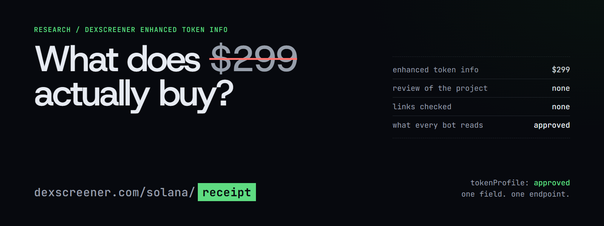
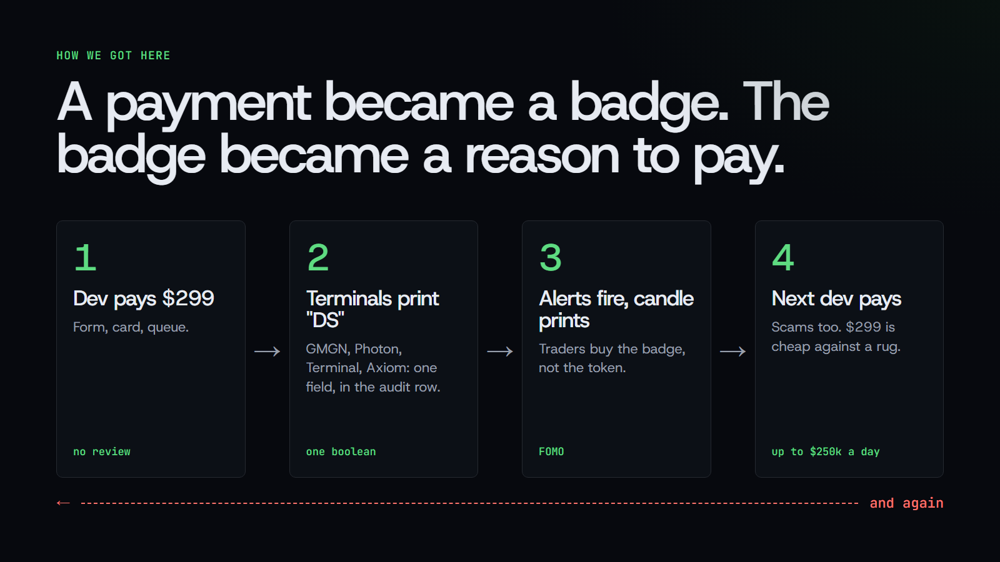
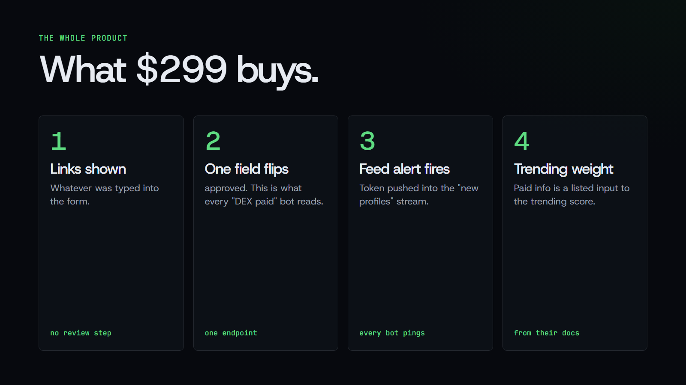
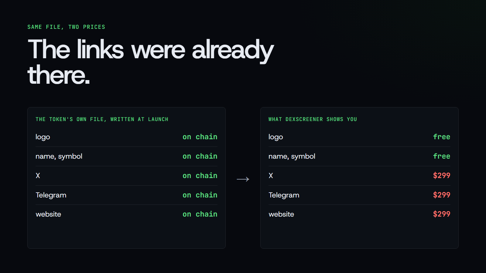
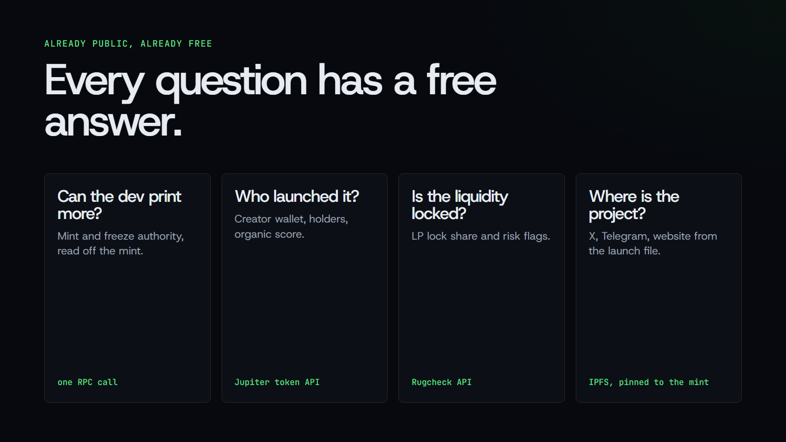
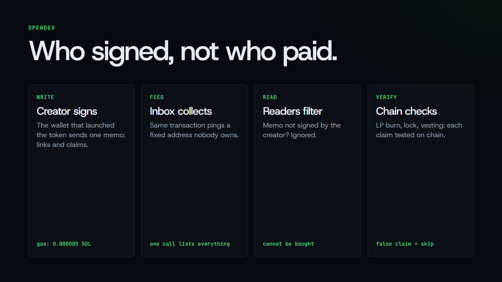
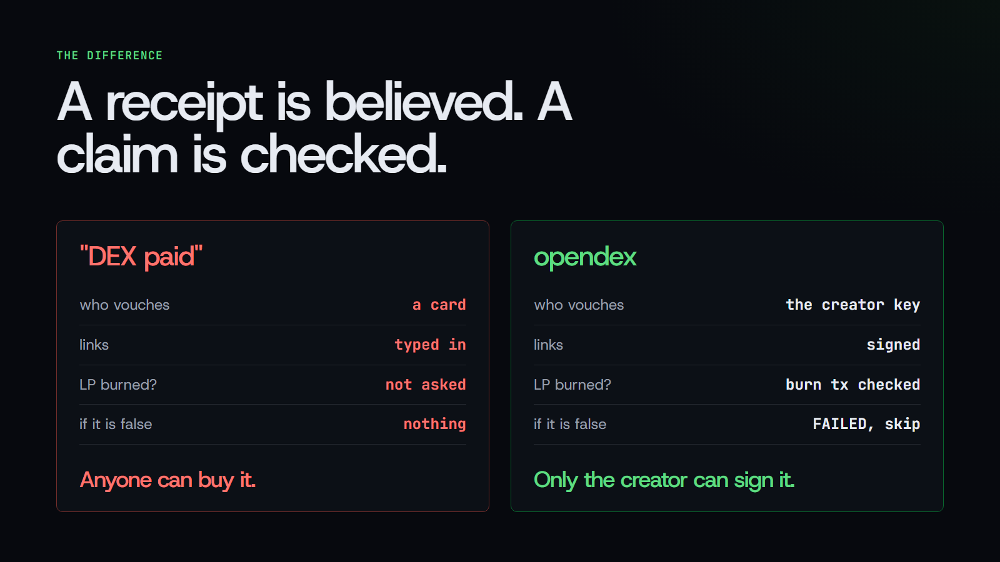

# What does $299 buy on Dexscreener?

*A manifesto for opendex. How a chart site became the toll booth for trust on Solana, why every terminal prints a receipt and calls it a signal, why the links behind that receipt were on the chain from block one, and how a creator can publish the same thing, better, for one gas fee.*

## TL;DR

- Dexscreener sells **Enhanced Token Info** for $299. It is a form, a payment and a queue. The marketplace page lists no review of the project, and the terms say Dexscreener "does not adjudicate" what is submitted.
- "DEX paid" is a single API field, **tokenProfile: approved**. GMGN stamps it on every card in Trenches with a timer. Photon prints it next to Mint Authority. pump.fun's own Terminal draws a green Dexscreener icon on the card and lets you filter on it. Axiom filters on it. Rick and Phanes alert on it. Telegram channels exist for nothing else. All of them are reading one boolean that means: the money arrived.
- For a pump.fun token, the X, Telegram and website links were written into an **IPFS file at launch** and pinned to the mint. Dexscreener reads that file, shows the logo from it, and hides the links until $299 arrives.
- Paying proves nothing about the project. The checker sites that popularised the badge say so in their own FAQ. Scams buy it too, and a scam has the marketing budget.
- **opendex** reads the free sources, lets the creator wallet publish updates with one signed memo, and checks claims on the chain. Cost: one gas fee, about 0.000005 SOL. No server, no key, no company in the middle.
- The question to ask a token is not "did the dev pay" but **"did the dev sign, and does the claim check out."**

## 1. How we got here

Nobody designed this. It accreted, and everyone who could have stopped it was getting paid.

Dexscreener started as a chart site: every pair on every DEX, one page per pool, free. The token page needed a logo and a few links, and the cheapest way to get them was to ask the project. So a form went up. The form became a product. The product got a price. The price got a strike-through, so that $299 would look like a discount on $499.

Then pump.fun turned token creation into a form of its own. A name, a symbol, an image, three links, and a token exists with a bonding curve and a pair. Thousands of these appear every day. Traders could no longer read each one. They needed a filter, and a filter needs a yes-or-no question that software can answer.

Dexscreener's orders endpoint answered one. "Did someone pay $299 for this mint?" GMGN put the answer on every card in Trenches, with a timer counting up from the moment the card was charged. Photon put it in the audit block, next to Mint Authority and LP Burned, as if it belonged there. Terminal, the trading app pump.fun bought and renamed, draws a green Dexscreener icon on the card and offers "Dex paid" as a filter toggle beside "Dev still holding". Axiom made it a filter. Rick made it a command and an alert. Phanes made it an alert. A Telegram channel with nothing in it but "DEX paid" notifications picked up four thousand subscribers. Bags.fm built the purchase into its launch flow so a dev could buy the badge before the first trade. A Chrome extension exists whose only job is to check it.

So the launchpad that writes your links to the chain for free also owns the terminal that hides them behind someone else's checkout. Nobody planned that. It is just where the incentives rolled.

A payment became a badge. The badge became a candle. The candle became a reason to pay.

By August 2024, DeFiLlama's founder estimated $150,000 to $250,000 a day flowing into token-profile fees. The Defiant later put it at over $1M a week, Solana by far the largest chain. A Coinbase director called Dexscreener's front page "nearly entire promoted bundled scams". The free route, a CoinGecko listing that Dexscreener imports automatically, takes days and requires traction, so almost nobody waits for it.

Along the way, the thing the badge was supposed to stand for got lost. Nobody at Dexscreener claims it is a safety signal. The checker sites say in their own FAQ that it is not. And still every terminal prints it in green, between the real audit fields, where a new trader cannot tell the difference between "mint authority revoked" and "someone paid".

That placement is the whole trick. Nobody lied. They just put a receipt in the row where the facts go.

We think this happened because the convenient thing and the honest thing came apart, and nobody built the honest thing in a convenient shape. That is what opendex is for.

## 2. What "DEX paid" actually is

A token page on Dexscreener has two states. Before payment: chart, trades, name, symbol and logo. After payment: the same page with a banner, a description and links to X, Telegram and a website.

Behind that is one purchase, Enhanced Token Info, listed at "$499, now $299". The marketplace page describes what you get: logo and socials displayed, "credibility", "community engagement", and a self-reported circulating supply so the market cap "displays correctly". Processing: "most orders within a few minutes, allow up to 12 hours."

Read that list again. "Credibility" is sold as a line item. Nothing in it is a check on the project. It is a display setting.

What happens when the payment lands, from Dexscreener's docs and public API:

- The icon, banner, description and links are shown on the token page.
- The token is pushed into the profiles feed and its WebSocket. Every "new profile" alert fires.
- The order appears in the public orders endpoint as **tokenProfile: approved**. This one field is what every "DEX paid" badge, filter and alert reads.
- "Verified info, especially those with Enhanced Token Info" is listed as an input to the trending score.

That is the whole product. The badge the community treats as a trust signal is a purchase receipt that other software reads.

Dexscreener does not pretend otherwise. Its terms make the buyer "responsible for ensuring the legality, authenticity, and accuracy of all metadata". Its docs say the paid path is for speed, "regardless of listing status on external third party services". Even tokens launched on Moonshot, Dexscreener's own launchpad, show up in the orders API with a paid profile and a payment timestamp. The house charges its own tables.

A receipt is not a lie. It is a receipt. The lie is in the green.

## 3. The links were already on the chain

When a pump.fun token launches, the creator types name, symbol, description, image, X, Telegram and website into the launch form. pump.fun writes all of it to one JSON file on IPFS and puts that file's address on the mint account itself. The update authority is null, so the record is immutable from block one. Every wallet reads it. That is where Phantom gets the logo.

Dexscreener reads the same file. It displays the image from it. It hides the links from the same file until $299 arrives.

We checked this on a live unpaid pump.fun token: logo visible on Dexscreener, socials absent, an "Update Token Info" link pointing at the $299 order page, and the X, Telegram and website links sitting in the IPFS file the logo came from. On a second token with a profile order placed two minutes earlier and still processing, the page already showed Website and Twitter. The links come through the paid pipeline or not at all.

Think about what that means. The server fetched the file. It parsed the JSON. It took the image field and rendered it. It took the twitter field and threw it away, and in its place rendered a button that says "Update Token Info" and leads to a checkout. That is not a missing feature. That is a feature.

Everything else a trader wants is also public and free:

- **Mint and freeze authority revoked:** one RPC call on the mint.
- **Creator wallet, holder count, organic score, verified badge:** Jupiter's token API, already shown in Phantom.
- **LP locked and risk flags:** Rugcheck's summary API.
- **Logo and socials on Solscan, and Jupiter's Verified badge:** free forms, anyone can submit.

Rick's own social finder already falls back to on-chain metadata when Dexscreener has nothing. GMGN, Photon and Terminal render the on-chain socials on their own cards. The data path exists in every terminal on Solana. Only the label is gated, and the label is what the terminals chose to print in colour.

Three of those sources are run by companies that could charge and do not. The paywall is a Dexscreener decision, not a property of the data.

## 4. What the receipt does not tell you

- **That the links are real.** Dexscreener displays what was typed into the form.
- **That the team is safe.** The checker sites that popularised "DEX paid" say so in their own FAQ: "Paying for Dex Screener is not a guarantee that a project is safe."
- **Where the price goes.** Paying marks a deployer with a marketing budget, not a project with a future. The order has no bearing on the chart.
- **Whether the dev is still there.** If the deployer sells, the banner stays. The timer on GMGN keeps counting.
- **Who paid.** The order has a timestamp and a status. It has no signer. Anyone with a card can buy a profile for any mint, including a mint they did not launch. Terminal's own docs describe the badge as "token creator updated enhanced token info". Nothing in the order proves it was the creator.

The one thing it proves: someone spent $299. A scammer who expects to extract more than $299 spends it too. Run the numbers from the other side: if you are about to pull a six-figure rug, $299 for a green icon in every terminal on the chain is the best marketing spend available to you, and nobody will ask who you are.

## 5. Why the community pays anyway

Because the receipt is convenient and nothing else was.

1. **It is one boolean at one URL.** Sniper bots want a yes or no, and the orders endpoint gives one.
2. **pump.fun metadata is immutable.** When a dev loses the X account or a community takes over, Dexscreener's profile is the only widely read place where links can change. Dexscreener sells mutability because the chain does not offer it by default.
3. **The profiles feed is the only public stream** of "someone just put effort into this token."
4. **A banner and a description look like a project page.** Looking like a project is cheaper than being one.
5. **The costly-signal story is comfortable.** "If they paid, they have a budget." Axiom's own help text says as much. It is true and it is useless: a budget for marketing is exactly what a rug has.
6. **The terminals put it where the facts go.** Once a green Dexscreener icon sits next to "mint revoked" on every card, not paying looks like failing an audit. The badge is not a signal. It is a tax on not looking like a scam, collected by a company that does not check whether you are one.

Fix those six and the receipt has nothing left to signal.

## 6. What we believe

**Trust is a signature, not a payment.** The only party who can vouch for a token is the key that created it. A payment from an unknown card says nothing about that key. A transaction signed by it says everything the chain can say.

**Data that is already public stays public.** The links, the authorities, the holders, the liquidity: these are facts on a public ledger. A reader that hides them behind a fee is not a reader, it is a toll booth.

**A claim is worth only what can be checked.** "We burned the LP" is marketing. "The LP burn is in this transaction" is a claim a program can verify. Software should display the second kind and label the first kind.

**A false claim is more useful than no claim.** The creator who writes a burn signature that does not contain a burn has told you exactly who they are. A verifier that prints FAILED does more for a trader than a badge that prints approved.

**No company in the middle.** No server to rate-limit, no API key to revoke, no moderator to persuade, no terms that can be changed on a Tuesday. The chain is the database, the inbox address is the feed, the reader's browser is the backend.

**Free means free.** One gas fee to write, nothing to read. Anything more and the next toll booth is already being built.

**The audit row is sacred.** Mint authority, freeze authority, LP, creator: those are facts. A receipt does not belong in that row. Any terminal that puts it there is selling Dexscreener's product for free.

## 7. opendex: who signed, not who paid

opendex is four pieces of free software and one convention.

**Read.** A static page and a browser extension build a trust card for any mint from the free sources above. The extension draws it on the Dexscreener page itself, next to the hidden links. The Dexscreener receipt is shown as what it is: "someone paid $299 on this date."

**Write.** The creator wallet, the one that deployed the token, publishes a link update by sending one transaction containing an SPL Memo. The memo starts with opendex:v1: and carries the mint, the links, a short note and claims. Readers accept a memo only when the fee payer is the creator wallet, taken from Jupiter's dev field or the mint's update authority. Anyone else is ignored. Nobody can buy this record; only the key that launched the token can sign it. Cost: one gas fee, about 0.000005 SOL.

**Feed.** The same transaction includes a zero-lamport transfer to a fixed inbox address. The address is derived from a hash and is off the ed25519 curve, so no private key exists for it and nobody controls it. One RPC call, the signature list for that address, returns every opendex update ever published, newest first. That is the "new profiles" feed with no company in the middle.

**Verify.** Links are self-reported and labelled as such. The part of the memo that carries information is the claims: an LP burn transaction, an LP lock transaction, a vesting account, a list of dev wallets. Every reader checks them on the chain: the burn transaction must contain a burn, the lock must be confirmed, the account must exist. A claim that fails is shown as FAILED, and a false claim is a skip flag. That is the one kind of signal a purchase receipt never produced.

This solves the six reasons people pay. One RPC call gives a yes or no: did the creator sign. The memo gives mutability to immutable metadata, because the creator can publish a new one any time. The inbox gives the feed. The card gives the project page. The costly signal is replaced by a checkable one. And the audit row gets a fact in it instead of a receipt.

## 8. What it costs and why it can be free

Reading a card, running the extension and listing the feed are free. Publishing a creator update costs one Solana gas fee.

It can be free because the page is one HTML file and one script, served from anywhere or opened from disk. The RPC calls run in the reader's own browser against a public endpoint, so there is no server to pay for and nothing to rate-limit except the reader's own connection. There is nothing to moderate: the chain decides who the creator is, and claims verify themselves. The inbox address is the feed, so there is no feed server. Nobody has to be trusted, so nobody has to be paid.

The code is open and the memo format is one page in the README. Anyone can write a reader. Anyone can write a memo without our page. The convention is the product; the software is a reference. If opendex disappears tomorrow, every memo already on the chain still reads.

## 9. Limits

- **Not a safety rating.** A token with real links, burned LP and a verified creator can still go to zero.
- **Not a trending list.** Dexscreener's trending score and boosts are their business; opendex ranks nothing.
- **Not a Dexscreener replacement.** The extension uses Dexscreener's public API only to resolve a pair to a mint and to show the receipt line. Their API terms forbid products "whose primary purpose is to compete directly with DEX Screener's product." opendex's purpose is verification, and every Dexscreener call in it is optional.
- **Not spoof-proof against the creator.** A scammer who deployed a token can publish a memo about it. What they cannot do is publish a claim that verifies on the chain without doing the thing the claim describes.
- **Public RPC is rate-limited per visitor.** A reader who hits the limit waits and retries. Heavy users bring their own endpoint.
- **Memos are v1.** Solana Attestation Service is the proper long-term home for creator attestations. Memos ship today with no program and no cost beyond gas. The format carries a version prefix so readers can move.

## 10. What should happen next

**Terminals** should move the green icon out of the audit row and print "creator signed" and the claim results in its place. GMGN, Photon, Terminal, Axiom: the data is one RPC call away and the field is just as binary. You already render the on-chain socials. Stop charging your users' attention for Dexscreener's checkout.

**pump.fun** has both halves. It writes the links to the chain at launch and it owns the terminal that prints the badge. One extra instruction in the create transaction and every token is born with a signed record, and the terminal can read it the same hour.

**Bots** should alert on a signed memo with verified claims, not on a payment. The inbox is one address. Watch it.

**Launchpads** should write the memo at launch. Bags.fm already wires a Dexscreener purchase into its launch flow; wiring a free memo is less code.

**Creators** should sign their own links and attach the claims they can back. A burn signature costs nothing to include and is worth more than a banner.

**Traders** should treat a false claim as the skip flag it is, and a receipt as the receipt it is. When a terminal shows a green Dexscreener icon where the facts go, ask who that row is for.

**Dexscreener** can read the inbox for free, the way it reads the image today. Nothing stops it. If it does, the $299 goes back to being what it was supposed to be: a banner.

**We** are publishing the page, the extension, the memo format and the research as open source, and we are putting the first memos on the chain ourselves.

## 11. Conclusions

1. "DEX paid" is one field in one endpoint. It means a form was filled and $299 arrived.
2. It became a trust signal because it was convenient, not because it was true. Terminals needed a boolean, Dexscreener sold one, and the terminals printed it in the row where the facts go.
3. The links it unlocks were in the token's own metadata from the first block. Dexscreener shows the logo from that file and sells the rest of it.
4. The receipt proves one thing: $299 was spent. Scams spend it too.
5. The community pays because the receipt is convenient: one boolean, one feed, one place links can change. All three can be free.
6. A signature from the creator key, plus claims that verify on the chain, gives traders a better boolean at a lower cost with nobody in the middle.
7. The question to ask a token is not "did the dev pay" but **"did the dev sign, and does the claim check out."**

*Sources: Dexscreener marketplace, docs and API terms (October 2026); Dexscreener public API; GMGN Trenches and Photon token pages viewed logged out (October 2026); Terminal (ex Padre) Trenches docs, archived copy; docs.axiom.trade, docs.rick.bot, docs.phanes.bot, docs.bags.fm; DeFiLlama and The Defiant revenue figures; crypto.news on Dexscreener and scams (February 2025); on-chain checks on live pump.fun tokens. Details in research/FINDINGS.md, memo format in README.md.*
